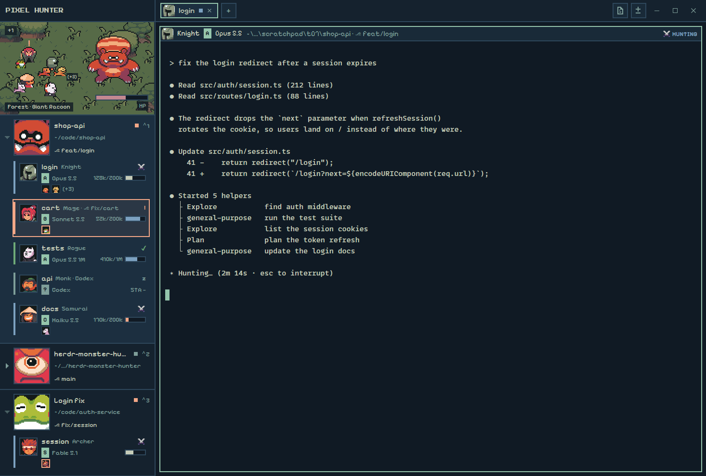

# Pixel Hunter — a Herdr layout

A monster-hunting, 8-bit pixel RPG layout for the [Herdr app](https://herdr.dev),
with only original characters: spaces become hunting Areas with their own
Monster, and agents become a Party of Hunters. Everything lives in
[`pixel-hunter/`](pixel-hunter/); see its [RECIPE.md](pixel-hunter/RECIPE.md).



## Install

Ask your Herdr agent to add this repo's `pixel-hunter/` folder, or copy
`pixel-hunter/layouts/*` into `~/.config/herdr-app/layouts/`,
`pixel-hunter/themes/*` into `~/.config/herdr-app/themes/` and
`pixel-hunter/mods/*` into `~/.config/herdr-app/mods/`, then run
`layout.switch pixel-hunter`. `ctrl-shift-l` switches back. The theme file is
needed: the layout names `pixel-hunter-night`. If the pixel fonts don't show at
once, restart Herdr (they load at start and on a look change).

The mod runs no programs and reaches no network. Outside its own folder it
only reads `~/.config/herdr-app/data/pixel-hunter/sessions/` (see below).

## Rank and Stamina (optional, Claude Code)

Each Hunter row shows its **Rank** (a letter grade and the model, like
`[A] Opus 5.5`), the context tokens used out of the window (`128k/200k`,
`410k/1M`) and its **Stamina** (the context window left, as a bar).
Herdr doesn't know either, so they come from a small Claude Code
[statusLine](https://docs.claude.com/en/docs/claude-code/statusline) script
that ships with the mod. Without it every Hunter shows its program name
(`[?] Claude Code`, `[?] codex`) and `STA —`. Nothing is ever estimated.

One-time setup (needs `node` on your PATH): add this to `~/.claude/settings.json`
(or a project's `.claude/settings.json`):

```json
{
  "statusLine": {
    "type": "command",
    "command": "node ~/.config/herdr-app/mods/pixel-hunter/statusline.mjs",
    "refreshInterval": 60
  }
}
```

- The script reads the session JSON Claude Code sends it, and writes the
  model's name, `context_window.remaining_percentage`,
  `context_window.total_input_tokens` and `context_window.context_window_size`
  for the Herdr
  terminal it runs in (`HC_TERMINAL_ID`) to
  `~/.config/herdr-app/data/pixel-hunter/sessions/<terminal>.json`. Control
  and bidi characters are stripped. Outside Herdr it writes nothing.
- It prints a short status line of its own (`Opus 5.5 · 62% context left`).
  To keep your own status line instead, call it from yours with `--quiet`,
  passing the same JSON on stdin:
  `input=$(cat); printf '%s' "$input" | node ~/.config/herdr-app/mods/pixel-hunter/statusline.mjs --quiet`.
- `refreshInterval` keeps a quiet session's record fresh. Without it, an idle
  session's Stamina is marked `old` after the freshness limit (5 minutes),
  because Claude Code only runs the script when the conversation changes.

Stamina is blue at 50% and up, cream from 20% to 50%, peach below 20%, and
dim with `old` once the record is older than the limit. The token number
shows only once Claude Code has reported both numbers and the first response
is in; a record written by an older copy of the script shows the bar alone.

### The grade table

`~/.config/herdr-app/mods/pixel-hunter/rank.json` maps a word in the model's
name to its grade. The first word found wins, case doesn't matter, and any
other model shows `?`. Saving the file updates the sidebar at once.

```json
{
  "grades": { "Fable": "S", "Opus": "A", "Sonnet": "B", "Haiku": "C" },
  "staleAfterSeconds": 300
}
```

`staleAfterSeconds` is the freshness limit. A broken file falls back to these
defaults.

## Pin a Class to a tab

Hunters take Classes (Knight, Mage, Archer, Rogue, Monk, Samurai) in order of
first appearance across all spaces, and keep theirs while they live. To give a
tab's Hunters a fixed Class, name the tab and pin it in
`~/.config/herdr-app/mods/pixel-hunter/classes.json`:

```json
{
  "tabs": { "api": "Mage", "web": "Archer" }
}
```

- Every Hunter in a tab called `api` (in any space) is a Mage, also after the
  tab is closed and opened again, or moved. A pin wins over the Class the
  Hunter had before.
- Tab and Class names match ignoring case and spaces around them. Only tabs
  someone named count: an unnamed tab is called by its number, which changes
  when tabs move.
- Hunters in other tabs still take Classes in order, using the Classes no
  pinned Hunter has first.
- An unknown Class name (`"Paladin"`) or a broken file is ignored, and those
  tabs get Classes in order. Removing a pin keeps the Hunter's current Class
  until it closes.
- Saving the file updates the sidebar, tabs and pane headers at once, with no
  restart.

The shipped file pins nothing: `{ "tabs": {} }`.

## License

The code is MIT (see [LICENSE](LICENSE)). The sprites and tiles are from the
[Ninja Adventure Asset Pack](https://pixel-boy.itch.io/ninja-adventure-asset-pack)
by pixel-boy and AAA, CC0 1.0 (see
[`art/CREDITS.md`](pixel-hunter/mods/pixel-hunter/art/CREDITS.md)). The fonts,
Pixelify Sans and Press Start 2P, are under the SIL Open Font License 1.1 (see
[`fonts/`](pixel-hunter/mods/pixel-hunter/fonts/)).
