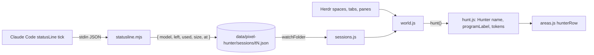

# Hunter row (layout F)

**Status:** built in Pets ticket 04; the Pet icon line in ticket 05. Design: layout **F** in `docs/records/2026-11-05-hunter-row.html`. Vocabulary follows `GLOSSARY.md` (Hunter, Class, Rank, Stamina, Needs help).

How a Hunter row in the sidebar gets its data and how it is drawn. Pane headers and tab pills read the same Hunter but draw it their own way. Layout F didn't change them.

## Contents

1. [What the row shows](#what-the-row-shows)
2. [Data flow](#data-flow)
3. [Hunter fields](#hunter-fields)
4. [Token records](#token-records)
5. [Rendering](#rendering)
6. [Tests and checks](#tests-and-checks)

## What the row shows

```
▌ [face]  login  Knight · Codex · ⎇ fix/cart        ⚔
▌ [38px]  [A] Opus 5.5              128k/200k [████  ]
▌         [Dog][Cat] [+3]
```

- **Strip:** 4 px down the left edge, in the state colour (blue Hunting, peach Needs help, green Cleared, dim Resting).
- **Line 1:**
  - the tab name (semibold)
  - in dim text, joined by ` · `: the Class, the program only when it isn't Claude Code, and the branch only when it differs from the Area's
  - the state icon on the right, with the state's name as its tooltip
- **Line 2:** the grade tag and the model. On the right: used/total context tokens, then the 44 px Stamina bar. The bar shows what's **left**; the number shows what's **used**.
- **No data:** `STA —` and no number.
- **Needs help:** the row keeps its 2 px peach frame and peach tint.
- **Pets** (only when the Hunter has any): a third line of 18 px animal icons, at most 2, then `[+N]`. See `pet-tracking-hooks.md` for where Pets come from.

## Data flow



## Hunter fields

`hunt()` adds three fields to each Hunter (`mods/pixel-hunter/hunt.js`):

| Field | Value | Rule |
| --- | --- | --- |
| `name` | `"login"` | The Herdr tab's name, trimmed (an unnamed tab is `tab 1`, as Herdr calls it). If the tab has no name at all, the Class name. The name never changes the Class. |
| `programLabel` | `"Codex"` or `null` | Null when the pane's `app` is `claude-code`, when the program name is Claude Code (`Claude Code`, `claude`), or when no program is known. Otherwise, the program name as Herdr gives it. |
| `tokens` | `{ used: 128000, size: 200000, text: "128k/200k" }` or `null` | From the session record's `used` and `size`. Null unless both are present and `used > 0` (used is `0` before the first response). `tokenText()` writes thousands as `k` and millions as `M` with at most one decimal (`410k/1M`, `1.5M`). |

`rank`, `stamina` and `branch` are unchanged. A record from before ticket 04 has no `used`/`size`, so its Hunter gets `tokens: null` and still has its Stamina bar.

## Token records

`statusline.mjs` records `used = context_window.total_input_tokens` and `size = context_window.context_window_size`. Ticket 01 verified both fields (see `pet-tracking-hooks.md`). Each is a rounded whole number ≥ 0, or `null` when it's missing or not a number. A `size` of 0 is stored as `null`. Neither is ever computed from `used_percentage` or `remaining_percentage`, and `left` is never computed from the tokens. A record with only tokens (no model, no percentage) is still written. A change in `used` or `size` rewrites the record at once, like the other fields. The record version stays `v: 1`, because the fields are additive.

## Rendering

`hunterRow()` in `mods/pixel-hunter/areas.js`:

- **Outer row:** `h_flex` with `items_stretch`. It is indented 16 px, with 4 px vertical and 6 px right padding, no left padding, and an 8 px gap.
- **Strip:** a 4 px `div` with the state colour as its background. Because the row stretches its children, the strip spans the full content height.
- **`body`:** a `v_flex` that holds one `h_flex` (the face, then the two lines). With Pets, `petLine()` adds the Pet icon line as a second child under that `h_flex`, so the strip grows with it:
  - Indented 46 px (the 38 px face and the 8 px gap), 3 px below the lines, icons 3 px apart.
  - Each icon is an 18 px `div` with a 1 px `border` frame on canvas, holding the animal's 38 px `art/animals/<Animal>/Faceset.png` scaled to 16 px. Its tooltip is `type · description`. A click runs `agent.focus` for the Hunter's terminal and stops there, so the row's own click doesn't run too.
  - `[+N]` is 12 px `dim`, 2 px further on. Its tooltip lists the hidden Pets, one per line: `Animal: type · description`.
  - Ticket 06 adds the 2 px peach frame for a Pet that Needs help.
- **Line 1:**
  - The name `div` truncates but doesn't grow.
  - The dim text is `flex_1` and truncates first.
  - The icon is `flex_none`.
- **Line 2:**
  - The grade tag comes first.
  - The model is `flex_1` and truncates.
  - On the right, a `flex_none` group holds the tokens (12 px) and `staminaView()`. A stale record shows `old` before the bar.
- **Width:** at the 320 px sidebar the text column is about 216 px wide. A long model name such as `Sonnet 5.5 (1M context)` truncates before the tokens do.

## Tests and checks

- `test/statusline.test.js`, black-box:
  - tokens recorded for 200k and 1M windows
  - the first tick (`used: 0`, percentages null)
  - absent and odd token fields (null, never derived)
  - a change in used tokens written at once
- `test/hunt.test.js`:
  - the tab name and its Class fallback
  - `programLabel` for Claude Code and others
  - token text for 200k/1M windows, and null without data
  - an old record without tokens showing only the bar
- Screenshots in `.scratch/pixel-hunter-pets/issues/04-shots/`:
  - the live window, using a temporary space with fake agents and records written through the real script
  - the demo snapshot (`demo.js` now carries the record's five Hunters)
  - the record rendered by headless Chrome
