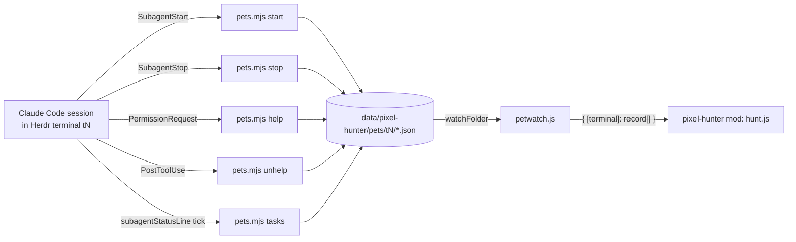

# Pet tracking: Claude Code hooks

**Status:** built. Ticket 05 built `pets.mjs` `start`, `stop` and `tasks`, the folder watcher, the hunt-model rules and the sidebar's Pet icons. Ticket 06 built `help` / `unhelp` and Pet Needs help. Ticket 07 built Pets in the arena. Decided in the 2026-11-05 Pet discussion and checked against real Claude Code sessions in tickets 01 and 05; vocabulary follows `GLOSSARY.md` (Pet, Hunter, Party, Hunting, Needs help).

A **Pet** is a Claude Code subagent (Agent tool, formerly Task) running inside a Hunter's agent. Herdr cannot see these: they run inside the Hunter's terminal and have no terminal of their own. So Claude Code has to write them down for the mod. It does that through hooks and a `subagentStatusLine` command that call one small script. Without that setup no Pet is ever shown, and nothing is guessed.

This extends the optional statusLine setup from ticket 06 (`statusline.mjs`, Rank and Stamina). It uses the same folder conventions and the same safety rules.

## Contents

1. [What the user sees](#what-the-user-sees)
2. [Data flow](#data-flow)
3. [The script: `pets.mjs`](#the-script-petsmjs)
4. [Records on disk](#records-on-disk)
5. [Claude Code settings](#claude-code-settings)
6. [Hunt model rules](#hunt-model-rules)
7. [Verified behaviour (ticket 01)](#verified-behaviour-ticket-01)
8. [Built in ticket 05](#built-in-ticket-05)
9. [Built in ticket 06](#built-in-ticket-06)
10. [Built in ticket 07](#built-in-ticket-07)

## What the user sees

- Under each Hunter row: one line of Pet icons (the animal's face, 18 px), at most 2, then `[+N]`. Needs help first, then Hunting, then oldest. Hovering an icon shows the subagent type and the description the Hunter gave it. See layout F in `docs/records/2026-11-05-hunter-row.html`.
- In the arena: up to 2 animal sprites at 2× at each drawn Hunter's feet, plus `[+N]`. Hunting Pets swap their two frames; a Pet that Needs help stands under a blinking `!`, like a Hunter that Needs help.
- A Pet that Needs help gets a 2 px peach frame on its icon, expands its Area and turns the Area dot peach, the same as a Hunter. Pane headers and tabs don't change: the prompt already shows in the Hunter's terminal.
- A Pet that is Hunting keeps the Monster alive (no Slain) and keeps HP wearing down.
- When a Pet finishes it disappears. There is no Cleared Pet.
- Clicking a Pet icon focuses its Hunter's terminal. Hovering `[+N]` lists the hidden Pets.

## Data flow



Every hook process inherits the terminal's environment, so `HC_TERMINAL_ID` (set by Herdr) tells the script which Hunter the Pet belongs to. Outside a Herdr terminal, or with an id that isn't a plain id, the script writes nothing.

## The script: `pets.mjs`

The script is plain Node with no Herdr imports, at `mods/pixel-hunter/pets.mjs` next to `statusline.mjs`. It reads the hook JSON on stdin. The first argument picks the action. It always exits 0, prints nothing and never blocks Claude Code.

| Action | Called by | Input fields used | Effect |
| --- | --- | --- | --- |
| `start` | `SubagentStart` hook | `session_id`, `agent_id`, `agent_type` | Creates the Pet record. Picks an animal from the 10 small animals, skipping any already used by this terminal's live Pets until all 10 are taken. The first choice is seeded from `agent_id`, so a subagent that stops and is resumed (same `agent_id`, see below) usually comes back as the same animal. |
| `stop` | `SubagentStop` hook | `agent_id` | Deletes the Pet record (the `<terminal>` folder stays). A missing record is fine: SubagentStop also fires for Claude Code's internal agents. |
| `help` | `PermissionRequest` hook | `agent_id` (only when the prompt comes from a subagent) | Sets `state: "help"`, `helpAt` and `seenAt` (now) on that Pet's existing record. With no `agent_id`, the prompt is the Hunter's own and the action does nothing; it never creates a record. |
| `unhelp` | `PostToolUse` hook | `agent_id` | Sets `state: "hunting"` again and drops `helpAt`: the Pet got past its prompt and ran a tool. It writes only when the record is in `help`, so the usual tool call writes nothing. A denied prompt fires no `PostToolUse`; the Pet then leaves at `SubagentStop`, or the next `tasks` tick clears it (below). |
| `tasks` | `subagentStatusLine` command, every tick | `tasks[]`: `id`, `agentType`, `status`, `description` | For each task that has a record and isn't finished, fills in `type` and `description` and refreshes `seenAt` (the heartbeat). It never creates a record. A `completed` / `failed` / `killed` task deletes its record, unless the record's last start (`startAt`) is under 10 s old (see ticket 05 below). A tick never arrives while a permission prompt is open, so a `help` Pet whose `helpAt` is more than 2 s (`HELP_TICK_MS`) before the tick, or that has no `helpAt`, goes back to `hunting` (written at once). |

The animals are Cat, Dog, Dog2, Cub, Frog, Racoon, Monkey, Chicken, Pig and Fish (Ninja Adventure `Actor/Animal/*/Faceset*.png` at 38×38, and `SpriteSheet*.png` with two 16×16 frames; Cub is the pack's `LionCub`, and Monkey, Chicken, Pig and Fish use the Brown, White, Pink and Red variants). Cow, Horse and Lion are too big for a Pet. They are copied from the official pack zip to `art/animals/<Animal>/Faceset.png` and `SpriteSheet.png`, listed in `art/CREDITS.md`.

Rules shared with `statusline.mjs`:

- Strip C0/C1 controls, DEL and bidi marks from `description` and `type`, and cap them at 80 chars.
- Write via a temp file and rename, falling back to an in-place write on Windows.
- `$PIXEL_HUNTER_PETS` overrides the folder and `$HERDR_APP_HOME` the Herdr home.
- `HC_TERMINAL_ID` and `agent_id` must already be plain ids (`[A-Za-z0-9._-]`, not `.` or `..`); unlike `statusline.mjs`, nothing is stripped from them first.
- Any action other than `start`, `stop`, `tasks`, `help` and `unhelp` does nothing.
- `start` counts a sibling in `help` as live whatever its `seenAt`, so its animal stays taken and it is never cleared as a leftover.
- `tasks` rewrites a record only when its content changes or its `seenAt` is 30 s old, so a busy tick doesn't redraw the window every second.

## Records on disk

```
<appHome>/data/pixel-hunter/pets/<HC_TERMINAL_ID>/<agent_id>.json
```

Each Pet gets its own file, so parallel subagents starting at once never race on a shared file.

```json
{
  "v": 1,
  "app": "claude-code",
  "terminal": "t6",
  "session": "5f0c…",
  "agent": "a1b2c3",
  "type": "Explore",
  "description": "find auth middleware",
  "animal": "Dog",
  "state": "hunting",
  "startedAt": 1793900000000,
  "seenAt": 1793900042000,
  "startAt": 1793900000000
}
```

`state` is `"hunting"` or `"help"`; `helpAt` (ms) is present only with `"help"`. Before the first `tasks` tick, `type` comes from the hook's `agent_type` and `description` is empty. `startAt` is when the last `start` came; `startedAt` stays the first start while the record exists (a start after a stop is a new record).

## Claude Code settings

These go in the user's `~/.claude/settings.json`. The setup guide shows them, but nothing edits the file for the user (same rule as ticket 06). Merge them with any hooks the user already has. The README's Pets section shows the `subagentStatusLine` and all four hooks (ticket 06 added `PermissionRequest` and `PostToolUse`).

```json
{
  "statusLine": {
    "type": "command",
    "command": "node ~/.config/herdr-app/mods/pixel-hunter/statusline.mjs",
    "refreshInterval": 60
  },
  "subagentStatusLine": {
    "type": "command",
    "command": "node ~/.config/herdr-app/mods/pixel-hunter/pets.mjs tasks"
  },
  "hooks": {
    "SubagentStart":     [{ "hooks": [{ "type": "command", "command": "node ~/.config/herdr-app/mods/pixel-hunter/pets.mjs start" }] }],
    "SubagentStop":      [{ "hooks": [{ "type": "command", "command": "node ~/.config/herdr-app/mods/pixel-hunter/pets.mjs stop" }] }],
    "PermissionRequest": [{ "hooks": [{ "type": "command", "command": "node ~/.config/herdr-app/mods/pixel-hunter/pets.mjs help" }] }],
    "PostToolUse":       [{ "hooks": [{ "type": "command", "command": "node ~/.config/herdr-app/mods/pixel-hunter/pets.mjs unhelp" }] }]
  }
}
```

- `refreshInterval` is ticket 06's 60 s and has no effect on Pets. `subagentStatusLine` runs on its own 5 s timer whenever the agent panel shows a row, also while the Hunter is idle (measured in ticket 01).
- `PostToolUse` fires for every tool call. `pets.mjs unhelp` returns at once when the input has no `agent_id`, so the cost is one short Node start per tool call. If that turns out to be too slow, match it to subagent tool calls only.
- The tool used to be called `Task` (renamed `Agent` in Claude Code 2.1.63). The hooks above don't match on the tool name, so the rename doesn't matter.

## Hunt model rules

Built in tickets 05 and 06 as below.


`hunt.js` gets a new input `pets` (`{ [terminal]: record[] }`, read by a `watchFolder` adapter like `sessions.js`) and a `petStaleAfterSeconds` setting (default 120, in the same config as `staleAfterSeconds`).

- **Owner.** A Pet belongs to the Hunter whose terminal matches the folder name. Nested subagents are flattened: every subagent in the session is a direct Pet of the Hunter, and no tree is drawn.
- **Dropped.** A Pet is dropped when its Hunter's terminal is gone or is no longer an agent, when its `seenAt` is older than `petStaleAfterSeconds` (for example after a Claude Code crash where SubagentStop never fired). A Pet in `help` is never dropped as stale: no tick arrives while its prompt is open, however long the user takes, or when its `app` differs from the pane's app.
- **Order.** Needs help first, then Hunting, then oldest `startedAt`. The first 2 are `shown`, and the rest count toward `more` (`[+N]`).
- **Party.** Pets are members of the Party. The Area's worst state, the Needs help auto-expand and the HP wear all include them. The Monster is Slain only when no Hunter **or Pet** is Hunting and at least one Hunter is done.
- **Classes.** Pets take no Class and never shift Class order.
- **Tests.** Add `node --test` cases for: the 2 + `[+N]` cut and order, the stale drop at the exact limit, a `help` Pet never dropped as stale, a Pet keeping the Monster alive, Pet Needs help raising the Area state, a Pet of a closed terminal ignored, and the no-duplicate animal pick (in `pets.mjs` black-box tests).

## Verified behaviour (ticket 01)

Tested on 2026-11-05 with Claude Code 2.1.318 (Opus 5.5, 1M context) on Windows, running in Herdr terminal `t24` (`hc run --no-parent -- claude --permission-mode default`). Temporary logging commands for the four hooks, `statusLine` and `subagentStatusLine` were set in a throwaway project's `.claude/settings.local.json`; the user's `~/.claude/settings.json` was not touched. Runs: one subagent with a Bash permission prompt (approved), a subagent that spawned a nested Explore subagent and then asked for permission (left open 114 s, then approved), a subagent whose prompt was denied with Esc, and a prompt from the main session. Payloads below are trimmed (`transcript_path`, `cwd`, `scratchpad_dir`, `effort` and paths cut).

### Answers

| Question | Answer | Seen |
| --- | --- | --- |
| Does `PermissionRequest` carry `agent_id` for a subagent's prompt? | **Yes**, with `agent_type`. A main-session prompt has neither field. | verified, 4 prompts |
| Does `tasks[].id` equal the hook `agent_id`? | **Yes**, and `tasks[].agentType` equals `agent_type`. Match on `id` alone. | verified |
| Does `SubagentStop` fire for background subagents? | **Yes.** In 2.1.318 every Agent-tool subagent ran in the background (`tool_response.status: "async_launched"`); the model said the tool has no foreground option, so a foreground subagent could not be tested. | verified for background; foreground not observed |
| Does `SubagentStop` fire for nested subagents? | **Yes**, for the child. The parent also gets `SubagentStop` when it ends its turn to wait for the child, then a second `SubagentStart` with the **same** `agent_id` when the child's result wakes it. | verified |
| Does `HC_TERMINAL_ID` reach hooks and `subagentStatusLine`? | **Yes**: all 114 logged runs (every hook, `statusLine`, `subagentStatusLine`) had `HC_TERMINAL_ID=t24`, plus `HC_SCOPE` and `HC_TERMINAL_SOCKET`. | verified |
| `subagentStatusLine` settings shape | `{ "type": "command", "command": "…" }`, as documented. `refreshInterval` was not tried on it: it is not documented there and isn't needed. | verified shape |
| Does it tick while the Hunter is idle? | **Yes**: every 5.0 s while the agent panel shows at least one row, including while the main session sat idle. It keeps ticking a finished task as `completed` for about 25–30 s, then the row goes and the ticks stop. | verified |
| Relation to statusLine `refreshInterval` | **None.** With `refreshInterval` 3 and then 10, `statusLine` ticked every 3 s and then 10 s, while `subagentStatusLine` stayed at 5 s both times. | verified |
| Ticks during a permission prompt | **None at all**, from either command, while any prompt is open (114 s for a subagent prompt, 21 s for a main-session one). Ticks resume as soon as it closes. | verified |
| Does statusLine report used and total context tokens? | **Yes**: `context_window.total_input_tokens` (used; input + cache creation + cache read) and `context_window.context_window_size` (total, `1000000` here). Both exist from the first tick; used is `0` before the first API response. | verified |

Other things seen:

- `SubagentStop` also fires for Claude Code's internal agents (prompt suggestions) with `agent_type: ""` and no matching `SubagentStart`. `stop` already ignores a missing record.
- A denied prompt (Esc) fires no `PostToolUse`. The subagent then replied and stopped, so `SubagentStop` removed it 4.7 s later.
- `PostToolUse` fires inside subagents with their `agent_id`, including the nested parent's own `Agent` call. The main session's `Agent` call has no `agent_id`.
- `tasks[].description` stays the text the Hunter gave; `label` becomes a progress summary ("Writing probe text to probe1.txt"). Use `description`.
- Launching `claude` with `hc run` from inside another Claude Code session passes that session's `CLAUDECODE`, `CLAUDE_CODE_SESSION_ID` and similar variables on to it, and it then started in auto mode. Unset them (or start it from the Herdr app) when testing.

### What changed in the design

- **Needs help is never stale.** No tick arrives while a prompt is open, so with the 120 s limit a Pet waiting on the user would be dropped. A Pet in `help` is exempt from `petStaleAfterSeconds` (see Hunt model rules).
- **A tick clears Needs help.** Since ticks stop while any prompt is open, a `tasks` tick more than 2 s after `helpAt` means the prompt is closed: the Pet goes back to `hunting`. This covers a denied prompt and a tool that fails after approval, where no `PostToolUse` comes. `PostToolUse` stays as the fast path.
- **Resumed Pets.** A nested parent leaves and comes back under the same `agent_id`. Seeding the animal pick from `agent_id` makes it come back as the same animal when that animal is free.
- **No statusLine change for Pets.** The `subagentStatusLine` keeps its own 5 s heartbeat, so the statusLine `refreshInterval` stays at ticket 06's 60 s.

### Captured payloads

`SubagentStart`:

```json
{ "session_id": "1d775e05-…", "prompt_id": "5612294f-…", "agent_id": "a87b73ce5f399ecb8",
  "agent_type": "general-purpose", "hook_event_name": "SubagentStart" }
```

`subagentStatusLine` stdin, 0.3 s later:

```json
{ "session_id": "1d775e05-…", "prompt_id": "5612294f-…", "columns": 194,
  "tasks": [{ "id": "a87b73ce5f399ecb8", "type": "local_agent", "agentType": "general-purpose",
    "status": "running", "description": "probe fg write", "label": "probe fg write",
    "startTime": 1793884484634, "model": "claude-opus-5-5", "contextWindowSize": 1000000,
    "tokenCount": 0, "tokenSamples": [0], "cwd": "C:\\…\\hookprobe\\proj" }] }
```

`PermissionRequest` from that subagent (a main-session one has the same shape without `agent_id` and `agent_type`):

```json
{ "session_id": "1d775e05-…", "permission_mode": "default",
  "agent_id": "a87b73ce5f399ecb8", "agent_type": "general-purpose",
  "hook_event_name": "PermissionRequest", "tool_name": "Bash",
  "tool_input": { "command": "echo probe > probe1.txt", "description": "Write probe text to a file" },
  "permission_suggestions": [{ "type": "addDirectories", "directories": ["C:\\…\\hookprobe\\proj"], "destination": "session" }] }
```

`PostToolUse` after approval:

```json
{ "agent_id": "a87b73ce5f399ecb8", "agent_type": "general-purpose", "hook_event_name": "PostToolUse",
  "tool_name": "Bash", "tool_input": { "command": "echo probe > probe1.txt" },
  "tool_response": { "stdout": "", "stderr": "", "interrupted": false },
  "tool_use_id": "toolu_01Bbdy…", "duration_ms": 1408 }
```

`SubagentStop`:

```json
{ "agent_id": "a87b73ce5f399ecb8", "agent_type": "general-purpose", "hook_event_name": "SubagentStop",
  "stop_hook_active": false, "agent_transcript_path": "…\\subagents\\agent-a87b73ce5f399ecb8.jsonl",
  "last_assistant_message": "done",
  "background_tasks": [{ "id": "a87b73ce5f399ecb8", "type": "subagent", "status": "running",
    "description": "probe fg write", "agent_type": "general-purpose" }], "session_crons": [] }
```

Nested run, in order (ms timestamps):

```
1793884597047 SubagentStart      a0c676b0626300806 general-purpose   (parent)
1793884600559 SubagentStart      ac4a9a06bc885e83a Explore           (child)
1793884603699 SubagentStop       a0c676b0626300806                   parent ends its turn
1793884605560 tasks              parent:completed, child:running
1793884610194 SubagentStop       ac4a9a06bc885e83a                   child done
1793884610383 SubagentStart      a0c676b0626300806 general-purpose   parent resumed, same id
1793884613983 PermissionRequest  a0c676b0626300806 Bash
              (no statusLine or subagentStatusLine tick for 114 s)
1793884728458 PostToolUse        a0c676b0626300806 Bash              approved
1793884733503 SubagentStop       a0c676b0626300806
```

statusLine `context_window` after a few turns:

```json
{ "total_input_tokens": 68586, "total_output_tokens": 86, "context_window_size": 1000000,
  "current_usage": { "input_tokens": 4, "output_tokens": 86,
    "cache_creation_input_tokens": 42, "cache_read_input_tokens": 68540 },
  "used_percentage": 7, "remaining_percentage": 93 }
```

Before the first response the same object read `total_input_tokens: 0`, `context_window_size: 1000000`, and `null` for `current_usage`, `used_percentage` and `remaining_percentage`.

### Not verified

- A foreground (blocking) subagent: none could be started in 2.1.318.
- A tool that fails after approval (would fire `PostToolUseFailure`, not `PostToolUse`). The tick rule above covers it either way.
- Whether `subagentStatusLine` accepts a `refreshInterval` of its own.

Sources: Claude Code docs, [hooks](https://code.claude.com/docs/en/hooks.md), [subagents](https://code.claude.com/docs/en/sub-agents.md), [status line](https://code.claude.com/docs/en/statusline.md).

## Built in ticket 05

Files in `mods/pixel-hunter/`:

- `pets.mjs`: the hook script, actions `start`, `stop`, `tasks` (above). Tests: `test/pets.test.js`, black-box (spawned with env and stdin, like `test/statusline.test.js`).
- `petwatch.js`: `startPets(self, cx)` keeps `self.pets` (`{ [terminal]: record[] }`, undefined until the first read). It watches `<appHome>/data/pixel-hunter/pets/` with `watchFolder` (creating it), and re-reads `<terminal>/<agent>.json` on each change: plain names only, at most 64 terminals and 256 records in all. It has no timer.
- Every role that runs `world()` starts it (sidebar, tab bar, pane headers), because Pets change the Monster's persisted state: a role without them would write Slain while another writes Hunting. `world()` writes no persisted state until both the pins and the Pets are read. The demo sidebar uses `demoPets()` from `demo.js` instead.
- `hunt.js`: `hunt({ …, pets })`, `petsOf()`, `ANIMALS`, `PETS_SHOWN = 2`. `rankTable()` reads `petStaleAfterSeconds` (default 120) from `rank.json`. Each Hunter gets `pets: { shown, more, all }`, each Pet `{ agent, type, description, animal, state: "hunting", startedAt, staleAt }`. A record is ignored without a string `agent`, a known `animal` or a numeric `seenAt`, or when its `app` differs from the pane's. It is dropped when `now >= seenAt + petStaleAfterSeconds × 1000`. Order: `PRIORITY` of the state, then `startedAt`, then `agent`. The Area's `worst` and the Monster's Party include Pets (Hunting, never done). Tab dots, `arenaPick` and Classes don't.
- `sidebar.js`: `wakeAt()` also takes the earliest Pet `staleAt`, so the existing single one-shot timer redraws when the next Pet is due to leave.
- `areas.js`: `petLine()` under the face-and-lines row inside `body` (see `hunter-row.md`).

### Verified behaviour (ticket 05)

Run on 2026-11-05 with Claude Code 2.1.318 in a temporary Herdr space (terminal `t2k`), with the README's block (plus the statusLine) in a throwaway project's `.claude/settings.local.json`. The `~` commands ran as given on Windows.

- Four background subagents that each ran one long foreground command (`ping -n 45/60/75`, an Explore read): four records within 4 s, two icons and `[+2]`, `[+1]` once the Explore one finished, the count dropping as the pings ended, and no line after the last. Animals were all different. `seenAt` moved after 30 s.
- **A subagent that waits isn't running.** Subagents told to `sleep 70` had the foreground sleep blocked and ran it as a background shell, then ended their turn. Claude Code fired `SubagentStop` and the ticks called their tasks `completed` while the agent panel still listed them and the shells ran. When a shell finished, the subagent got a new `SubagentStart` with the same `agent_id`, and the ticks said `completed` for up to one more tick before `running`. So, as for the nested parent in ticket 01, a waiting subagent has no Pet, and its Hunter's Monster can be Slain meanwhile. The `tasks` status can't tell waiting from done, so this can't be fixed in the script.
- **The stale tick race.** Without a guard, that stale `completed` tick deleted the record the new `SubagentStart` had just written (seen live). `tasks` now leaves a record alone for 10 s (`START_GRACE_MS`, two ticks) after its last start. A real end still deletes it at `SubagentStop`, or after the grace on the next `completed` tick.
- **Stale drop.** A hand-written record 110 s old showed its Pet, which was gone at 123 s without any other record change.

## Built in ticket 06

- `pets.mjs`: actions `help` and `unhelp` and the tick fallback (see the table above). Tests in `test/pets.test.js`: help/unhelp toggle state and `helpAt`, nothing without `agent_id` or for an unknown Pet, a tick at 1.5 s keeps Needs help and one at 2.5 s clears it, and a `help` sibling keeps its animal.
- `hunt.js` `petsOf()`: a Pet's `state` is `"help"` when the record says so, else `"hunting"`. A `help` Pet is never dropped as stale and its `staleAt` is `null` (`sidebar.js` `wakeAt()` skips it). An Area is `expanded` and `held` when a Hunter **or a Pet** Needs help. Tab dots (`tabsOf`) and pane frames still use the Hunters only.
- `areas.js` `petLine()`: a Needs help icon has a `FRAME` (2 px) `blocked` (peach) border instead of the 1 px `border` one, with the face shrunk to 14 px to fit; its tooltip starts with `Needs help · `.
- `demo.js`: cart's Frog and a new Monkey under Login fix's Hunter Need help, so the demo shows the frame and a non-current Area opened by a Pet.

### Verified behaviour (ticket 06)

Claude Code 2.1.318 in a temporary space (terminal `t2m`), manual permission mode, with the README block in a throwaway project's `.claude/settings.local.json`. Record states logged every 100 ms:

- A subagent's Bash prompt set `help` 2.4 s after its start; the icon showed the peach frame (the Hunter's own row was Needs help too, since Herdr sees the prompt in its terminal).
- Approving it set `hunting` (PostToolUse); the next prompt set `help` again 2.4 s later.
- Denying the next prompt with Esc: `hunting` came 8.3 s after `helpAt` (a tick, as no PostToolUse fires), and `SubagentStop` removed the record 0.8 s later.

## Built in ticket 07

- `arena.js`: `pets()` and `pet()` draw each drawn Hunter's `pets.shown` (no new hunt-model field). Each Pet is its animal's `art/x4/animals/<Animal>/SpriteSheet.png` (16 × 16 frames drawn at 2×, 32 px) with its top-left at (−16, +20) and (+16, +20) from the Hunter's slot. Each Hunter is followed by its Pets in slot order, so a lower slot stands in front of the Pets above it. The `[+N]` chip (10 px, canvas at 80%) is drawn last, at (−38, +36) from the slot on the left-hand slots (1 and 3) and (+46, +36) on the right-hand ones (2 and 4). Below the pair it would sit on the next Hunter's head, or on the caption under slot 4, and right of the pair on slot 1 it would cover slot 2's Hunter.
- Animation: a Hunting Pet's two frames sit under `before(0.5, 640)` / `after(0.5, 640)` opacity loops (320 ms each, like the Hunter's Idle/Attack swap); a Needs help Pet shows frame 0 under a 16 px `blocked` `!` with `.frames(["!", " "], 400)`, 14 px above its box. Element ids carry `<terminal>-<agent>`. No timer is added.
- The arena's `active` flag (the Resting `z` float and the Monster's idle strip while someone Needs help) now counts Pets that are Hunting or Need help too. The pick of the four Hunters (`arenaPick`) is still Hunters only.
- `tools/build-art.py` also writes the 10 animals' x4 sprite sheets (the rest of its output is pixel-identical; the five rebuilt Hunter strips came out with different PNG bytes, so the old files were kept).

### Verified behaviour (ticket 07)

- Demo snapshot (`demo: true`): login's Dog and Cat with `[+3]` right of them (slot 2), cart's Frog under a blinking `!` (slot 1), docs' Dog2 (slot 3), clear of the Monster, HP bar and caption. Back-to-back shots (about 50 ms apart): each Hunting Pet's pixels flip between two hashes about every 320 ms, the `!` every 400 ms.
- Live, Claude Code 2.1.318 in a temporary space, manual mode, with the README block in a throwaway project's `.claude/settings.local.json`: four subagents running `ping -n 60` gave the Knight in slot 1 a Chicken and a Dog with `[+2]` left of them, swapping frames. A bare `sleep 50` is refused by Claude Code's Bash tool, so those subagents ended at once. A subagent's `mkdir` prompt was answered within seconds, before a shot (not by the test), so the Needs help `!` was shot with a hand-written `help` record (Monkey) beside two live Hunting Pets: it took the first spot, under a blinking `!`, with `[+1]`.
- Calm: with the Hunter Resting and no Pets, 70 arena shots over 2.4 s had one hash.
