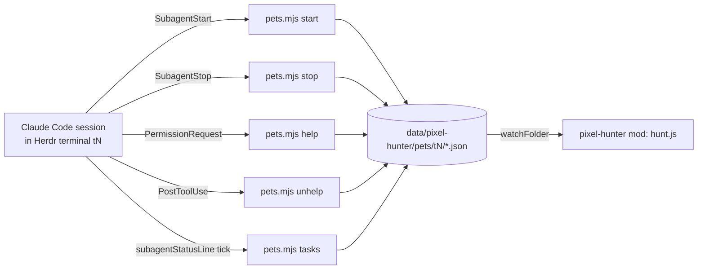

# Pet tracking: Claude Code hooks

**Status:** design, not built yet. Decided in the 2026-11-05 Pet discussion; vocabulary follows `GLOSSARY.md` (Pet, Hunter, Party, Hunting, Needs help).

A **Pet** is a Claude Code subagent (Agent tool, formerly Task) running inside a Hunter's agent. Herdr cannot see these: they run inside the Hunter's terminal and have no terminal of their own. So Claude Code has to write them down for the mod. It does that through hooks and a `subagentStatusLine` command that call one small script. Without that setup no Pet is ever shown, and nothing is guessed.

This extends the optional statusLine setup from ticket 06 (`statusline.mjs`, Rank and Stamina). It uses the same folder conventions and the same safety rules.

## Contents

1. [What the user sees](#what-the-user-sees)
2. [Data flow](#data-flow)
3. [The script: `pets.mjs`](#the-script-petsmjs)
4. [Records on disk](#records-on-disk)
5. [Claude Code settings](#claude-code-settings)
6. [Hunt model rules](#hunt-model-rules)
7. [Verify before relying on it](#verify-before-relying-on-it)

## What the user sees

- Under each Hunter row: one line of Pet icons (the animal's face), at most 2, then `[+N]`. Needs help first, then Hunting, then oldest. Hovering an icon shows the subagent type and the description the Hunter gave it. See layout F in `docs/records/2026-11-05-hunter-row.html`.
- In the arena: up to 2 animal sprites at 2× by each shown Hunter's feet, plus `[+N]`.
- A Pet that Needs help gets a peach frame on its icon, expands its Area and turns the Area dot peach, the same as a Hunter.
- A Pet that is Hunting keeps the Monster alive (no Slain) and keeps HP wearing down.
- When a Pet finishes it disappears. There is no Cleared Pet.
- Clicking a Pet icon focuses its Hunter's terminal. Hovering `[+N]` lists the hidden Pets.

## Data flow



Every hook process inherits the terminal's environment, so `HC_TERMINAL_ID` (set by Herdr) tells the script which Hunter the Pet belongs to. Outside a Herdr terminal, or with an id that isn't a plain id, the script writes nothing.

## The script: `pets.mjs`

The script is plain Node with no Herdr imports, at `mods/pixel-hunter/pets.mjs` next to `statusline.mjs`. It reads the hook JSON on stdin. The first argument picks the action. It always exits 0, prints nothing and never blocks Claude Code.

| Action | Called by | Input fields used | Effect |
| --- | --- | --- | --- |
| `start` | `SubagentStart` hook | `session_id`, `agent_id`, `agent_type` | Creates the Pet record. Picks an animal at random from the 10 small animals, skipping any already used by this terminal's live Pets until all 10 are taken. |
| `stop` | `SubagentStop` hook | `agent_id` | Deletes the Pet record. A missing record is fine: SubagentStop also fires for Claude Code's internal agents. |
| `help` | `PermissionRequest` hook | `agent_id` (only when the prompt comes from a subagent) | Sets `state: "help"` on that Pet. With no `agent_id`, the prompt is the Hunter's own and the action does nothing. |
| `unhelp` | `PostToolUse` hook | `agent_id` | Sets `state: "hunting"` again: the Pet got past its prompt and ran a tool. |
| `tasks` | `subagentStatusLine` command, every tick | `tasks[]`: `id`, `agentType`, `status`, `description`, `startTime` | For each `running` task, fills in `type` and `description` and refreshes `seenAt` (the heartbeat). A `completed` / `failed` / `killed` task deletes its record. |

The animals are Cat, Dog, Dog2, Cub, Frog, Racoon, Monkey, Chicken, Pig and Fish (Ninja Adventure `Actor/Animals/*/Faceset.png` at 38×38, and `SpriteSheet*.png` with two 16×16 frames). Cow, Horse and Lion are too big for a Pet. The art has to be fetched from the official pack zip, because the copy under `art/` has no animals yet. Add each file to `art/CREDITS.md`.

Rules shared with `statusline.mjs`:

- Strip C0/C1 controls, DEL and bidi marks from `description` and `type`, and cap them at 80 chars.
- Write via a temp file and rename, falling back to an in-place write on Windows.
- `$PIXEL_HUNTER_PETS` overrides the folder and `$HERDR_APP_HOME` the Herdr home.
- `tasks` rewrites a record only when its content changes or its `seenAt` is 30 s old, so a busy tick doesn't redraw the window every second.

## Records on disk

```
<appHome>/data/pixel-hunter/pets/<HC_TERMINAL_ID>/<agent_id>.json
```

Each Pet gets its own file, so parallel subagents starting at once never race on a shared file.

```json
{
  "v": 1,
  "app": "claude-code",
  "terminal": "t6",
  "session": "5f0c…",
  "agent": "a1b2c3",
  "type": "Explore",
  "description": "find auth middleware",
  "animal": "Dog",
  "state": "hunting",
  "startedAt": 1793900000000,
  "seenAt": 1793900042000
}
```

`state` is `"hunting"` or `"help"`. Before the first `tasks` tick, `type` comes from the hook's `agent_type` and `description` is empty.

## Claude Code settings

These go in the user's `~/.claude/settings.json`. The setup guide shows them, but nothing edits the file for the user (same rule as ticket 06). Merge them with any hooks the user already has.

```json
{
  "statusLine": {
    "type": "command",
    "command": "node ~/.config/herdr-app/mods/pixel-hunter/statusline.mjs",
    "refreshInterval": 5
  },
  "subagentStatusLine": {
    "type": "command",
    "command": "node ~/.config/herdr-app/mods/pixel-hunter/pets.mjs tasks"
  },
  "hooks": {
    "SubagentStart":     [{ "hooks": [{ "type": "command", "command": "node ~/.config/herdr-app/mods/pixel-hunter/pets.mjs start" }] }],
    "SubagentStop":      [{ "hooks": [{ "type": "command", "command": "node ~/.config/herdr-app/mods/pixel-hunter/pets.mjs stop" }] }],
    "PermissionRequest": [{ "hooks": [{ "type": "command", "command": "node ~/.config/herdr-app/mods/pixel-hunter/pets.mjs help" }] }],
    "PostToolUse":       [{ "hooks": [{ "type": "command", "command": "node ~/.config/herdr-app/mods/pixel-hunter/pets.mjs unhelp" }] }]
  }
}
```

- `refreshInterval` keeps ticks coming while the Hunter is idle and waiting on background subagents. Status-line updates are otherwise event-driven and go quiet then. Ticket 06 used 60 s. Pets need a few seconds, so the Pet heartbeat stays well under the stale limit.
- `PostToolUse` fires for every tool call. `pets.mjs unhelp` returns at once when the input has no `agent_id`, so the cost is one short Node start per tool call. If that turns out to be too slow, match it to subagent tool calls only.
- The tool used to be called `Task` (renamed `Agent` in Claude Code 2.1.63). The hooks above don't match on the tool name, so the rename doesn't matter.

## Hunt model rules

`hunt.js` gets a new input `pets` (`{ [terminal]: record[] }`, read by a `watchFolder` adapter like `sessions.js`) and a `petStaleAfterSeconds` setting (default 120, in the same config as `staleAfterSeconds`).

- **Owner.** A Pet belongs to the Hunter whose terminal matches the folder name. Nested subagents are flattened: every subagent in the session is a direct Pet of the Hunter, and no tree is drawn.
- **Dropped.** A Pet is dropped when its Hunter's terminal is gone or is no longer an agent, when its `seenAt` is older than `petStaleAfterSeconds` (for example after a Claude Code crash where SubagentStop never fired), or when its `app` differs from the pane's app.
- **Order.** Needs help first, then Hunting, then oldest `startedAt`. The first 2 are `shown`, and the rest count toward `more` (`[+N]`).
- **Party.** Pets are members of the Party. The Area's worst state, the Needs help auto-expand and the HP wear all include them. The Monster is Slain only when no Hunter **or Pet** is Hunting and at least one Hunter is done.
- **Classes.** Pets take no Class and never shift Class order.
- **Tests.** Add `node --test` cases for: the 2 + `[+N]` cut and order, the stale drop at the exact limit, a Pet keeping the Monster alive, Pet Needs help raising the Area state, a Pet of a closed terminal ignored, and the no-duplicate animal pick (in `pets.mjs` black-box tests).

## Verify before relying on it

These come from the Claude Code docs, but nobody has tested them here yet:

- That `tasks[].id` in the `subagentStatusLine` input equals the hook `agent_id`. If it doesn't, match on `agentType` plus `startTime` instead.
- That `PermissionRequest` input carries `agent_id` for a subagent's prompt. If it doesn't, Pet Needs help can't be told apart from Hunter Needs help, and the Pet stays Hunting.
- That `SubagentStop` fires for background subagents.
- That `HC_TERMINAL_ID` reaches hook processes and the `subagentStatusLine` process. The docs say hooks inherit the environment.
- The exact `subagentStatusLine` settings shape and whether it accepts `refreshInterval`.

Sources: Claude Code docs, [hooks](https://code.claude.com/docs/en/hooks.md), [subagents](https://code.claude.com/docs/en/sub-agents.md), [status line](https://code.claude.com/docs/en/statusline.md).
