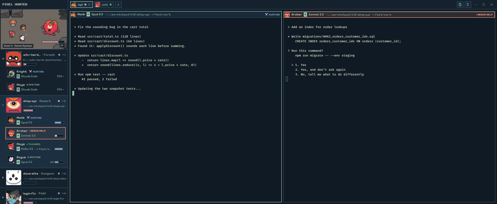

# Pixel Hunter

A monster-hunting, 8-bit pixel RPG skin for Herdr with only original characters.
Every space is a hunting **Area** with its own map and Monster, and every agent is a
**Hunter** in that Area's Party. A 320 px sidebar shows a little top-down arena where the
current Area's Hunters fight its Monster, then every Area with its Party underneath:
each Hunter's Class, what it's doing (⚔ Hunting, ! Needs help, ✓ Cleared, z Resting),
its model as a letter-graded Rank and its context left as a Stamina bar. The tab bar and
every pane header carry the Hunters' faces. Everything is drawn on a faded blue-cyan
dark theme with square 2 px frames, Pixelify Sans and CC0 sprites from the Ninja
Adventure pack. Whatever needs you is peach.



## What you see

Theme `pixel-hunter-night` (from `themes/pixel-hunter-night.json`): canvas and terminal
background `#101a24`, chrome `#15222e`, surface `#192a38`, selected `#1c2f40`, border
`#2e475b`, dim text `#7e9e99`, text `#c5ccb8`, accent (mint) `#95c5ac`, Hunting (blue)
`#7ca1c0`, Needs help (peach) `#f3a787`, Cleared (green) `#6eaa78`, HP (rose) `#c38890`.
Every frame and divider is 2 px, every radius 0. UI text is Pixelify Sans (15 px unless
given below); only the logo uses Press Start 2P. Terminals sit on the plain canvas with
10 x 8 px padding and no image behind the text.

Left to right:

### Sidebar: 320 px, fixed, `chrome`

1. **Logo row**, 44 px: `PIXEL HUNTER` in Press Start 2P 10 px, `#c5ccb8`, 12 px from
   the left (82 px on macOS, past the traffic lights). Dragging it moves the window.
2. **Arena**, 192 px plus a 2 px `border` line under it: the current Area's map, a
   160 x 96 art-px background shown at 2x (320 x 192), centred on canvas if the sidebar is
   wider. The six maps are Forest, Desert, Dungeon, Field, Ruins and Lakeside, muted and
   darkened toward the canvas so the sprites stand out.
   - The **Monster** stands on the right, its feet on (236, 128).
   - Up to **four Hunters** (16 px sprites drawn 32 px) stand on the left facing it, at
     (44, 52), (92, 70), (40, 104) and (88, 122), most urgent first. With more than four, a
     `+N` chip sits top-left (12 px text on canvas at 80% opacity).
   - Bottom-left, a caption `Desert · Demon Cyclops` (12 px, same chip style).
   - Bottom-right (right 12, bottom 8), the **HP bar**: 110 px wide, a 2 px `border`
     frame on canvas around an 8 px `#c38890` fill, with `HP` (`dim`) or `SLAIN`
     (`foreground`) under it in 12 px.
3. **Area list**, scrolls, one box per space, top to bottom in Herdr's space order. Each
   box has 8 px top, 10 px side and 10 px bottom padding and a 2 px `border` line under it.
   The current Area's box is `selected` `#1c2f40`.
   - A **chevron** column, 10 px wide and 76 px tall, at the far left: a pixel ▾ (open) or
     ▸ (closed), 10 px, `dim`, `foreground` on hover.
   - The **Monster's face**: 76 px (its 38 px faceset at 2x), 2 px `border` frame, spanning
     the Area's three lines.
   - Line 1: the space name (semibold, truncated), `· Forest` (`dim`), then on the right
     an 8 px square dot in the colour of the Party's most urgent state (`border` with no
     Hunters), and the shortcut that selects the space from the person's `keys.json`
     (`⌃1`, 13 px, `dim`).
   - Line 2 (13 px, `dim`): the folder of the space's first terminal, `~` for home, cut to
     `head/…/tail` past 30 characters, then `·` and its git branch in `foreground`. No
     branch outside git.
   - Line 3: the Monster's HP as a 64 px bar, drawn the same way as the arena's.
   - When open, the Area lists its **Hunter rows** under it, indented 16 px, 5 px apart,
     each with 6 x 4 px padding and an 8 px gap:
     - a 38 px Hunter face in a 2 px `border` frame;
     - line 1: the Class (semibold) and the state label in capitals, 13 px semibold, in
       the state's colour: `⚔ HUNTING` blue, `! NEEDS HELP` peach, `✓ CLEARED` green,
       `z RESTING` dim;
     - line 2 (13.5 px, `dim`): the Rank, a grade tag (12 px semibold `#101a24` text on a
       mint block, on `dim` for `?`) then the model (`Opus 5.5`), or with no record the
       program (`Claude Code`, `codex`); then `· ⎇ branch` only when the Hunter's branch
       differs from its Area's; then on the right the **Stamina** bar: 46 px, 2 px `border`
       frame on canvas, 8 px fill, blue `#7ca1c0` at 50% and up, cream `#c5ccb8` from 20%
       to 50%, peach `#f3a787` below 20%. `STA —` (`dim`) with no data. An old record
       shows `old` (12 px `dim`) before a `dim` fill.
     - A Hunter that Needs help gets a 2 px peach frame and a faint peach tint
       (`#f3a78712`) around its row. Other rows show `surface` on hover.

Hunter Classes and their Ninja Adventure characters: Knight (Knight), Mage
(SorcererBlack), Archer (Hunter), Rogue (NinjaMasked), Monk (Monk), Samurai (Samurai).
Maps and their Monsters: Forest, Giant Racoon; Desert, Demon Cyclops; Dungeon, Giant
Spirit; Field, Blue Tengu; Ruins, Red Warlord (the pack's GiantRedSamurai); Lakeside,
Giant Frog.

### Work column

1. **Tab bar**, 44 px, `chrome`, 10 px sides, 6 px gaps. The shown space's tabs, then
   `+`, then on the right Files and Changes, and on Windows and Linux the window buttons
   (minimise, maximise or restore, close; 32 px squares, `dim`, `surface` on hover).
   - Each tab is 32 px high with a 2 px frame, 4 px left and 10 px right padding and 8 px
     gaps: the tab's first Hunter's face (24 px, the faceset at 1:1 cropped 7 px in and
     5 px down), or a pixel map icon in `dim` when the tab has no agent; the tab name
     (max 170 px, truncated); Herdr's zoom icon (12 px) when zoomed; an 8 px dot in the
     tab's most urgent state colour (`border` with no agent). The shown tab is mint-framed
     on `selected` with `foreground` text and a 12 px × close icon; the others are
     `border`-framed on `surface` with `dim` text.
   - `+` is a 32 px square framed like a tab. Files and Changes are 32 px framed squares
     with 16 px pixel icons and tooltips; the one whose panel is open is mint-framed on
     `selected`.
2. **Work body**: 8 px padding, 8 px gap.
   - **Panes**: 8 px apart, 2 px `border` frames, the focused one mint `#95c5ac`, radius
     0. A pane that's alone in its tab is framed too.
   - **Pane header**, 30 px at the top of every pane, `surface` with a 2 px `border` line
     under it, 3 px left and 8 px right padding, 8 px gaps, 14 px text:
     - a Hunter's pane: its 24 px face, the Class (semibold), the grade tag, the Rank
       label (max 160 px), then `dim` `folder · ⎇ branch` (the pane's own folder, `~` for
       home, cut past 48 characters), then on the right the state label as in the sidebar
       (13 px semibold);
     - a shell: the program's 14 px icon and name (semibold), then folder and branch;
     - a mod pane (Files in a pane, say): its title;
     - `ZOOM` (13 px, `dim`) when zoomed; on hover, Herdr's split right, split down, zoom
       and close icons (14 px, `dim`, `selected` on hover).
     - A Hunter that Needs help turns its header peach: a 2 px `#f3a787` frame on a
       `#f3a7871f` tint, focused or not.
   - **Side panel**, hidden at start: a 360 px column (280 to 900) with a 2 px `border`
     frame, holding Herdr's own Files and Changes panels.

## How it behaves

**Agent statuses** (Herdr's status for each agent's terminal, from OSC 7501):

| Herdr status | Hunt state | Label and colour | Arena |
| --- | --- | --- | --- |
| `blocked` | Needs help | `! NEEDS HELP`, peach `#f3a787`, peach row frame, peach pane header | the Hunter's Item pose (hand raised) with a 20 px peach `!` blinking every 400 ms |
| `working` | Hunting | `⚔ HUNTING`, blue `#7ca1c0` | swaps Idle and Attack every 520 ms, the Attack 6 px forward (a lunge) |
| `done` | Cleared | `✓ CLEARED`, green `#6eaa78` | hops once (12 px up and down, 180 ms each way, Jump frame) when it turns Cleared, then idles |
| `idle` | Resting | `z RESTING`, dim `#7e9e99` | idles with a 14 px dim `z` that floats up and fades over 2.4 s while anyone in the Area is Hunting or Needs help, and holds still otherwise |

- The Area's dot, a tab's dot and the arena's order use the most urgent state: Needs
  help > Hunting > Cleared > Resting. The arena shows four Hunters picked that way (ties
  keep their order) and `+N` for the rest.
- Herdr shows `done` only until someone looks, then `idle`, so a Hunter you've seen
  finish reads Resting.

**The Monster** (per Area, cosmetic):

- While anyone in the Party is Hunting, it plays its Hit strip (90 ms a frame, there and
  back; the Giant Racoon has no Hit strip and plays its Attack) and shakes 2 px either way
  every 300 ms. Its HP wears down: it halves its way toward 5 every 4 minutes (100, 52
  after 4 min, 29 after 8), so only Slain reaches 0. The sidebar redraws once every 10 s
  for this, and only while some HP is wearing.
- With nobody Hunting and somebody's agent done (Herdr's `done`, or herdr-core still
  saying `done` after Herdr shows it as seen), the Monster is **Slain**: HP drops to 0
  (the bars drain over 600 ms), `HP` turns to `SLAIN`, and the Monster drops 14 px and
  fades to 35% over 600 ms. It stays Slain until someone Hunts again.
- Then a fresh Monster of the same map **Respawns** with HP 100 (the fall runs back up,
  the bars refill).
- With someone Needing help but nobody Hunting it idles (its Idle strip, 160 ms a frame);
  with everyone Resting or Cleared it stands still on its first frame. HP pauses.
- HP and Slain are kept across restarts (Herdr's shared state).
- With nobody Hunting or Needing help and no Stamina record about to go old, nothing
  redraws: no loops, no timers.

**Areas**:

- Spaces take maps in order, Forest, Desert, Dungeon, Field, Ruins, Lakeside, and cycle
  after six. The name is Herdr's space name (repo, then folder, then `~`), or the custom
  name once renamed.
- Open or closed: the current Area and any Area with a Hunter that Needs help are open,
  the others closed. Clicking the chevron toggles it without selecting the space, and that
  choice is remembered per space across restarts. Needs help always opens an Area; its
  chevron is then dimmed to 50%, does nothing, and says "Needs help keeps this Area open".
  A closed Area keeps its lines, dot, shortcut and HP and hides only its Hunters.
- Click an Area to select its space (`space.select`). Drag one onto another to move it
  there (`space.move`; a 2 px mint line shows where, the dragged Area at 50%). Right-click
  opens Herdr's space menu.

**Hunters**:

- Classes come in order of first appearance across all spaces (Knight, Mage, Archer,
  Rogue, Monk, Samurai), a new Hunter taking the Class fewest living Hunters have, and
  cycle after six. A Hunter keeps its Class while it lives.
- `classes.json` in the mod pins a Class to a tab name: `{ "tabs": { "api": "Mage" } }`.
  Every Hunter in a tab someone named `api` (in any space, ignoring case and spaces around
  it) is a Mage, also after the tab is closed and reopened or moved, and the pin wins
  over the Class it had. Unpinned Hunters still go in order, using unpinned Classes first.
  An unknown Class or a broken file is ignored. Removing a pin keeps the Hunter's current
  Class until it closes. Saving the file updates the sidebar, tabs and pane headers at once.
- Clicking a Hunter row shows its agent (`agent.focus`).
- **Rank and Stamina** come only from the optional Claude Code statusLine script
  `statusline.mjs`. It records the model's name and `context_window.remaining_percentage`
  per Herdr terminal. `rank.json` grades the model: the first of `Fable` S, `Opus` A,
  `Sonnet` B, `Haiku` C found as a word in its name (ignoring case), else `?`. A record
  older than `staleAfterSeconds` (300) is shown `old`. Without a record a Hunter shows
  `?`, its program and `STA —`; nothing is ever estimated. Saving `rank.json` regrades at
  once.

**Tabs**: click selects (`tab.select`), double-click renames (`tab.rename`), press on one
tab and release on another moves it there (`tab.move`), right-click opens Herdr's tab
menu, × closes the shown tab (`tab.close`), the wheel steps through tabs (`tab.prev` /
`tab.next`), `+` opens Herdr's new-tab menu. Files and Changes open their panel in the side
column, or close it if it's showing that one. Which panel is open is remembered per space:
switching spaces shows that space's choice. The window buttons minimise, maximise and close.

**Pane headers**: they follow the pane live (folder, branch, state). Clicking one focuses
its pane (`pane.focus`); the hover buttons split right or down (`pane.split`), zoom
(`pane.zoom`) and close (`pane.close`).

Keys are Herdr's own; the layout adds none.

## Built from

**Layout** `layouts/pixel-hunter.json`, root `row` (`titlebar: "none"`,
`traffic_lights: [16, 15]`, `theme: "pixel-hunter-night"`, `background: "canvas"`,
`ui_font: "Pixelify Sans"`, `terminal_padding: [10, 8]`, `radius: 0`, divider 2 px
`border`):

```
root (row)
├─ sidebar (column, 320 px, resizable: false, chrome)
│  ├─ logo  (block, 44 px, window_drag)   pixel-hunter {role: "logo"}
│  └─ areas (block)                       pixel-hunter {role: "sidebar"}
└─ work (column, resizable: false)
   ├─ tabs (block, 44 px, window_drag, chrome)   pixel-hunter {role: "tabs"}
   └─ work-body (row, padding 8, gap 8)
      ├─ main (block)  tab: "active"; pane: gap 8, radius 0, background "background",
      │                lone: true, border 2 "border", focus 2 "accent",
      │                header: pixel-hunter {role: "pane"}, height 30, top, reveal "always"
      └─ panel (column, hidden, 360 px, min 280, max 900, border 2 "border")
         └─ panel-body (stack, active "files")
            ├─ files   (block)  shipped mod files
            └─ changes (block)  shipped mod changes
```

**Theme** `themes/pixel-hunter-night.json`: background `#101a24`, foreground `#c5ccb8`,
selection `#2e475b`, cursor `#95c5ac`, ansi `#192a38 #c38890 #6eaa78 #be955c #7ca1c0
#a593a5 #68aca9 #c5ccb8 / #7e9e99 #f3a787 #95c5ac #c28d75 #9cbcd6 #c3a6c3 #8ec9c6
#dfe3d4`, and the `colors` listed in What you see, plus `popover` `#192a38`, `raised` and
`hover` `#1c2f40`, `input`, `muted`, `idle` and `unknown` `#7e9e99`, `accent_foreground`
and `solid_foreground` `#101a24`, `solid` `#95c5ac`, and a custom `hp` `#c38890`.

**Mod `pixel-hunter`** (one mod; `mod.json` `{ "place": "none", "title": "Pixel Hunter" }`).
`main.js` picks a role from `props().role` and runs that role's init once per copy:

- `logo` (`logo.js`), `sidebar` (`sidebar.js`: `arena.js` + `areas.js`; `demo: true`
  draws the fixed `demo.js` snapshot instead, for screenshots), `tabs` (`tabs.js`), `pane`
  (`pane.js`; Herdr adds `pane` and `terminal` to its props).
- `hunt.js`: the hunt model, pure and with no Herdr imports:
  `hunt({ spaces, panes, home, keys, state, sessions, ranks, pins, now }) -> { areas, panes, state }`.
  Maps, Monsters, Classes, states, arena pick, HP, Slain, Respawn, open or closed, Rank,
  Stamina and pins are all decided here, with time passed in. Tests: `node --test` in the
  mod folder (`test/hunt.test.js`, `test/statusline.test.js`, 48 cases).
- `world.js`: the only place that reads Herdr for the model (`spaces()`, `panes()`,
  `terminals()` for herdr-core's own `done`, `keys()`, `home()`). It keeps the model's
  state in `shared("pixel-hunter.state")`:
  `{ classes: {terminal: Class}, monsters: {spaceId: {hp, since, slain}}, collapsed: {spaceId: bool} }`,
  written only when it changes. Every role that draws Hunters calls it.
- `sessions.js`: reads `rank.json` once per load, and watches
  `<Herdr home>/data/pixel-hunter/sessions/` (`watchFolder`, creating the folder), re-reading
  the records (at most 256) on each change. Run by the sidebar and every pane header.
- `pins.js`: reads `classes.json` once per load. Until it's read, `world()` writes no state.
- `rank.json`: `{ "grades": { "Fable": "S", "Opus": "A", "Sonnet": "B", "Haiku": "C" }, "staleAfterSeconds": 300 }`.
- `classes.json`: ships as `{ "tabs": {} }`.
- `statusline.mjs`: the optional Claude Code statusLine script, plain Node with no Herdr
  imports. Run by Claude Code (not by Herdr) with
  `"statusLine": { "type": "command", "command": "node ~/.config/herdr-app/mods/pixel-hunter/statusline.mjs", "refreshInterval": 60 }`.
  It writes `{ v: 1, app: "claude-code", terminal, session, model, modelId, left, at }` to
  `<Herdr home>/data/pixel-hunter/sessions/<HC_TERMINAL_ID>.json` (`$PIXEL_HUNTER_SESSIONS`
  overrides the folder, `$HERDR_APP_HOME` the home), strips control and bidi characters,
  caps text at 80 characters, rewrites an unchanged record at most once a minute, writes
  nothing outside a Herdr terminal, prints `Opus 5.5 · 62% context left` (nothing with
  `--quiet`) and always exits 0.
- `theme.js`: font names, `FRAME = 2`, the night colours as fallbacks.
- `icons/`: 8-bit SVGs drawn on a pixel grid: `map.svg`, `files.svg`, `changes.svg`
  (16 px), `chevron-open.svg`, `chevron-closed.svg` (5 x 5 grid at 10 px).
- `fonts/`: Pixelify Sans Regular, SemiBold and Bold (github.com/eifetx/Pixelify-Sans)
  and Press Start 2P Regular (github.com/google/fonts), with `OFL-PixelifySans.txt` and
  `OFL-PressStart2P.txt` (SIL Open Font License 1.1).
- `tools/build-art.py` (Python 3 + Pillow, run from the mod folder): composes the six
  `art/arena/<map>.png` from `art/tiles/` (keeps 55% of the saturation, then mixes 36%
  toward `#101a24`; Desert 30% / 50%, Ruins 20% / 70%) and writes `art/x4/`, nearest-
  neighbour 4x copies of the arenas (`x4/arena/<map>-v1.png`), Hunter and Monster strips
  and Monster facesets. Re-runnable and pixel-exact.

**`herdr` functions used**: `props`, `spaces`, `panes`, `terminals`, `keys`, `home`,
`shared`, `setShared`, `run`, `openOverlay`, `window`, `layout`, `settings`, `theme`,
`appHome`, `readTextFile`, `watchFolder`; plus `fs/promises` `readdir` / `mkdir` for the
sessions folder and `localStorage` key `panels` (the tab bar's per-space panel memory). It
reads `shared("workspace.panels")` to know which panel buttons to show.

**Commands run**: `space.select`, `space.move`, `agent.focus`, `tab.select`, `tab.rename`,
`tab.move`, `tab.close`, `tab.prev`, `tab.next`, `layout.select`, `layout.show`,
`layout.hide`, `pane.focus`, `pane.split`, `pane.zoom`, `pane.close`, `window.minimize`,
`window.maximize`, `window.close`. Overlays: the shipped `menu` popup (`{ tab: "space" }`
and `{ tab: "tab" }`) and the shipped `new-menu` popup.

**Shipped Herdr mods it uses** (by name, not copied): `files` and `changes` (the side
panel), `menu` and `new-menu` (popups), and icons from `mods/pane/` (`zoom`, `unzoom`,
`close`, `split-right`, `split-down`) and `mods/tabs/` (`win-min`, `win-max`,
`win-restore`, `win-close`). It does **not** use the shipped `tabs` mod.

**Programs, network, files**: the mod runs no programs (`exec`, `hc`) and reaches no
network. Outside its own folder it reads (and creates) only
`<Herdr home>/data/pixel-hunter/sessions/`. The statusLine script, if the person sets it
up, writes there.

**Art** (`art/`, all from the **Ninja Adventure Asset Pack** by pixel-boy and AAA,
CC0 1.0; `art/CREDITS.md` maps every file to its pack path):

- `chars/<Char>/Faceset.png` (38 x 38) and `Idle.png`, `Attack.png`, `Jump.png` (64 x 16
  strips, columns down/up/left/right; the arena uses the right-facing one) and `Item.png`
  (16 x 16) for Knight, SorcererBlack, Hunter, NinjaMasked, Monk, Samurai.
- `boss/<Boss>/Faceset.png` (38 x 38), Idle strips (frames x size: Racoon 6 x 60, Cyclop
  5 x 50, Spirit 5 x 50, Tengu 6 x 68, Red Samurai 12 x 48, Frog `Idle40x40.png` 5 x 40)
  and Hit strips (Cyclop 3 x 50, Spirit 3 x 50, Tengu 8 x 68, Red Samurai 8 x 48, Frog
  3 x 40; Racoon `Attack.png` 4 x 60). Monsters are aligned by their feet (the row under
  their lowest opaque pixel): Racoon 55 (Attack 60), Cyclop 43, Spirit 48, Tengu 51 (Hit
  60), Red Samurai 44 (Hit 46), Frog 33.
- `tiles/`: TilesetNature, TilesetField, TilesetFloor, TilesetFloorDetail, TilesetWater,
  TilesetDungeon (sources for the arenas).
- `arena/` and `x4/`: made by `tools/build-art.py` (still CC0).

## Watch out

- **Copy the theme too.** The layout names `pixel-hunter-night`, which lives in
  `themes/`, not in the layout or the mod. Without `themes/pixel-hunter-night.json` the
  window falls back to another theme. The fonts load from `mods/pixel-hunter/fonts/` at
  start and on the next look change, so on a fresh install they may need a restart (or a
  theme switch) to appear.
- **No peach frame around a whole pane.** Herdr draws pane frames itself from the tab
  block's `pane.border` / `pane.focus`, one colour for every pane, with no per-pane or
  per-status option. So a Hunter that Needs help gets a peach **header**, and a focused
  pane that Needs help keeps Herdr's mint outer frame around it. The model already says
  peach wins (`paneFrame`), for when Herdr can draw it.
- **Keep the panel ids** `panel`, `panel-body`, `files` and `changes`. The tab bar's Files
  and Changes buttons (and Herdr's own per-space panel memory) look for them.
- The shipped Files and Changes panels draw their own slightly rounded inner corners;
  only the layout's own frames are square.
- **Rank and Stamina need the statusLine script**, which needs `node` on PATH and the
  person's own `~/.claude/settings.json` (the mod never edits it). Claude Code runs a
  statusLine only when the conversation changes unless `refreshInterval` is set, so set
  `refreshInterval: 60`, or an idle session goes `old` after the 5-minute limit. Only
  Claude Code writes records: codex and others show `?`, their program and `STA —`. The
  statusLine's `HC_TERMINAL_ID` must reach the script (herdr-core sets it in the
  terminal's environment). Records of closed terminals aren't deleted; they go stale and
  show only if a live agent pane has that terminal id.
- **Pins match named tabs only.** An unnamed tab is called by its number, which changes
  when tabs move, so it never matches a pin. A removed pin keeps the Hunter's Class until
  it closes.
- **Herdr turns `done` into `idle` once you look**, so in the Area you're watching a
  finished agent reads Resting at once. The Slain rule also reads herdr-core's own status
  (`terminals()`), which keeps `done`, so the Monster still falls.
- **HP needs a slow redraw.** Herdr doesn't redraw the sidebar while an agent works, so
  the sidebar arms one 10 s one-shot timer while HP wears (and one for the moment a
  Stamina record turns old). Don't add repeating timers; nothing else redraws on its own.
- **GPUI smooths scaled images.** Every sprite drawn bigger than 1:1 uses a 4x
  nearest-neighbour copy from `art/x4/` drawn at 2x. Herdr caches images by file name, so
  a changed arena needs a new name (`ARENA_VERSION` in `arena.js` and `tools/build-art.py`).
- **Pixelify Sans quirks**: its `fi`/`fl` ligatures read like an "A", so every name, path
  and branch goes through `plain()` (a zero-width non-joiner after `f`). It has no `▸`/`▾`
  (hence the SVG chevrons) and no `⚔` (a system glyph stands in). `5` looks like `S` and
  `B` like `8` at 12 to 14 px (`Opus 5.5` reads `Opus S.S`).
- **`herdr-app check` renders the mod without props**, so it only checks the role-less
  `div`. A role that throws at render (`.flex_shrink()` with no argument, say) passes the
  check. Always look at the real window (`herdr-app shot`, `herdr-app status`).
- **Every pane header runs the whole model** and its own session-folder watch. Fine for a
  handful of panes.
- **Monster frames** play as stacked images inside nested linear opacity loops (GPUI
  clamps opacity, so a loop from -1000 to 1000 works as a square wave); there is no
  frame-strip element.
- Limits: four Hunters in the arena, six Classes and six maps before they repeat, 256
  session records, paths 30 characters in Area rows and 48 in pane headers, tab names
  170 px.
- Windows paths (`C:\Users\me\code\x`) show with their own separator, home matched
  ignoring case (`~\code\x`).
- The macOS traffic-light inset and the Linux window buttons weren't checked on those
  systems.

## Done when

- `herdr-app check ~/.config/herdr-app/mods/pixel-hunter` passes, and `node --test` in that
  folder passes all 48 tests.
- `layout.switch pixel-hunter` shows the 320 px sidebar (logo, arena, Area list), the 44 px
  tab bar and framed panes with 30 px Hunter headers; `herdr-app status` lists no errors.
- `PIXEL HUNTER` is in Press Start 2P and the rest in Pixelify Sans; frames are square 2 px.
- Each space is an Area with the next map (Forest, Desert, Dungeon, ...) and its Monster's
  76 px face; the arena shows the current Area's map and Monster.
- A fake agent (a terminal printing `ESC ] 7501 ; state=working BEL`) appears as a Hunter
  with the next Class and `⚔ HUNTING`; the Monster plays its Hit strip and shakes, and both
  HP bars wear down together.
- `state=blocked`: the row and the pane header turn peach, the arena Hunter raises a hand
  under a blinking `!`, and its Area opens and can't be closed.
- `state=done` with nobody else Hunting: `SLAIN`, both HP bars empty, the Monster sinks and
  fades. `state=working` again: it Respawns at full HP.
- With nobody Hunting or Needing help, two shots a few seconds apart are identical.
- Without the statusLine script every Hunter shows `?`, its program and `STA —`. Piping
  `{"model":{"display_name":"Opus 5.5"},"context_window":{"remaining_percentage":62}}` into
  `HC_TERMINAL_ID=<its terminal> node statusline.mjs` turns it into `A Opus 5.5` with a blue
  Stamina bar.
- `{ "tabs": { "<a named tab>": "Samurai" } }` in `classes.json` turns that tab's Hunter
  into a Samurai in the sidebar, the arena, the tab face and the pane header without a
  restart.
- Clicking the chevron toggles an Area without selecting it, and the choice survives
  `layout.switch main` and back.
- Files and Changes open Herdr's panels in the 360 px side column, and each space
  remembers its own.
